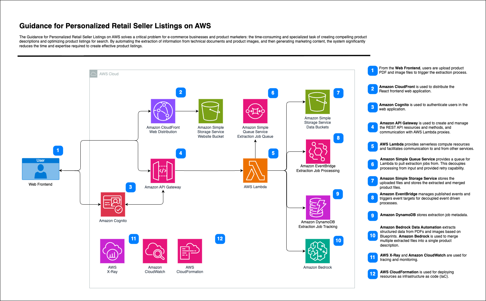

# Guidance for Personalized Retail Seller Listings on AWS

A serverless application that generates product descriptions and search keywords based on uploaded product PDF manuals and/or images of the product. The system processes these inputs, extracts relevant information, and generates marketing content.

## Table of Contents

- [Overview](#overview)
- [Architecture](#architecture)
- [Deployment Guide](#deployment-guide)
- [User Guide](#user-guide)
- [Technical Documentation](#technical-documentation)
- [Implementation Considerations](#implementation-considerations)
- [Pricing Information](#pricing-information)
- [Architecture Decision Records (ADRs)](#architecture-decision-records-adrs)
- [Security and Compliance Considerations](#security-and-compliance-considerations)

## License
Please note, this project is licensed under the MIT License. See LICENSE file for additional details.

## Overview

The Guidance for Personalized Retail Seller Listings on AWS is a serverless AWS application that helps e-commerce businesses and product marketers create compelling product descriptions and optimize product listings for search. By automating the extraction of information from technical documents and product images, and then generating marketing content, the system significantly reduces the time and expertise required to create effective product listings.

### Key Features

- Upload PDF manuals and product images
- Extract product information using AI
- Generate product descriptions and search keywords
- View and manage products through a web interface
- Update existing products with new information
- Secure authentication and authorization

## Architecture

The application follows a serverless, event-driven architecture with asynchronous processing. It consists of several key components:



### Key Components

1. From the Web Frontend, users are upload product PDF and image files to trigger the extraction process.
2. **Amazon CloudFront** is used to distribute the React frontend web application.
3. **Amazon Cognito** is used to authenticate users in the web application.
4. **Amazon API Gatewa** is used to create and manage the REST API resources and methods, and communication with AWS Lambda proxies.
5. **AWS Lambda** provides serverless compute resources and facilitates communication to and from other services.
6. **Amazon Simple Queue Service** provides a queue for Lambda to pull extraction jobs from. This decouples processing from input and provided retry capability.
7. **Amazon Simple Storage Service** stores the uploaded files and stores the extracted and merged product files.
8. **Amazon EventBridge** manages published events and triggers event targets for decoupled event driven processes.
9. **Amazon DynamoDB** stores extraction job metadata.
10. **Amazon Bedrock Data Automation** extracts structured data from PDFs and images based on Blueprints. **Amazon Bedrock** is used to merge multiple extracted files into a single product description.
11. **AWS X-Ray** and **Amazon CloudWatch** are used for tracing and monitoring.
12. **AWS CloudFormation** is used for deploying resources as infrastructure as code (IaC).

### Data Flow

1. User uploads product documents and images through the web interface
2. Files are stored in S3 and a processing job is created
3. Lambda functions process the files using Bedrock Data Automation
4. Extracted information is merged into a comprehensive product data sheet
5. User can view the generated product information on the website

## Deployment Guide

### Prerequisites

- AWS CLI configured with appropriate permissions
- Node.js 18+ and npm
- AWS CDK installed globally (`npm install -g aws-cdk`)
- AWS account with permissions to create the required resources
- [Enable foundation model access](https://docs.aws.amazon.com/bedrock/latest/userguide/model-access.html) in your AWS account:
  - Enable all Amazon and Anthropic models

### Step 1: Clone the Repository

```bash
git clone <remote_project_url>
cd guidance-for-personalized-retail-seller-listings-on-aws
```

### Step 2: Install CDK Dependencies

```bash
# Install CDK dependencies
cd cdk
npm install
```

### Step 3: Configure the Application

1. Create a copy of the template configuration files:

```bash
# CDK configuration
cd ..
cp cdk/bin/config/template.infra.config.json cdk/bin/config/infra.config.json
```

2. Edit the CDK infra configuration file with your specific settings:

>*cdk/bin/config/infra.config.json:*
```json
{
    "stackPrefix": "PDG",
    "env": {
        "account": "<YOUR_AWS_ACCOUNT>",
        "region": "<YOUR_AWS_REGION"
    },
    "cdkNag": true
}
```

### Step 4: Deploy the AWS Infrastructure

```bash
# Bootstrap the AWS Region
cd cdk
cdk bootstrap

# Deploy the CDK Project
cdk deploy --all
```

This will deploy all the stacks:
- StorageStack (S3 buckets, DynamoDB tables)
- AuthStack (Cognito authentication)
- QueueStack (SQS queues)
- EventBusStack (EventBridge event bus)
- LambdaFunctionsStack (Lambda functions)
- ApiStack (API Gateway)
- BedrockResourcesStack (Bedrock Data Automation)
- EventRulesStack (EventBridge rules)
- ProductWebsiteStack (Website hosting)

### Step 5: Configure Website Environment Variables

After deploying the infrastructure, you'll need to set up environment variables for the website.

1. Create a copy of the template configuration files:

```bash
# Website configuration
cd ..
cp website/src/config/template.runtime.config.json website/src/config/runtime.config.json
```

2. Edit the runtime configuration file with your specific settings:

>*website/src/config/runtime.config.json:*
```json
{
  "userPoolId": "<USER_POOL_ID>",
  "userPoolWebClientId": "<USER_POOL_CLIENT_ID>",
  "restApiEndpoint": "<API_GATEWAY_URL>"
}
```

### Step 6: Create a Cognito User

```bash
# Create a user in the Cognito User Pool
aws cognito-idp admin-create-user \
  --user-pool-id <USER_POOL_ID> \
  --username admin \
  --user-attributes Name=email,Value=<your-email@example.com> Name=email_verified,Value=true \
  --temporary-password Temp123!

# Set a permanent password for the user
aws cognito-idp admin-set-user-password \
  --user-pool-id <USER_POOL_ID> \
  --username admin \
  --password <YourStrongPassword123!> \
  --permanent
```

### Step 7: Deploy the Website

```bash
cd website

# Install website dependencies
npm install

# Deploy the website
npm run deploy
```

The deploy script will:
1. Build the React application
2. Upload the built files to the S3 bucket
3. Create a CloudFront invalidation to update the cache
4. Output the website URL

### Step 8: Cleanup

When you need to take down the deployment:

```bash
cd ../cdk

# Destroy all deployed AWS resources
cdk destroy --all
```

## User Guide

### Accessing the Application

1. Open the website CloudFront URL in your browser (provided at the end of the deployment process)
2. Sign in with the Cognito user credentials you created

### Uploading Product Files

#### Synthetic Product Data
Five synthetic products are included in this project in the `products` directory:
- [Coffee Maker](./products/coffee-maker-deluxe/input/)
- [Fitness Watch](./products//fitness-watch-pro/input/)
- [Noise Cancelling Headphones](./products/noise-cancelling-headphones/input/)
- [Premium Blender](./products/premium-blender/input/)
- [Robot Vacuum](./products/robotic-vacuum/input/)

#### Upload Instructions
1. After signing in, you'll be directed to the Upload page
2. Choose whether you're creating a new product or updating an existing one
   - For new products, the system will generate a product ID automatically
   - For existing products, select the product from the dropdown menu
3. Click "Choose Files" to select PDF manuals and/or product images
   - Supported file types: PDF, PNG, JPG, JPEG
4. Click "Upload Files" to start the upload process
5. You'll be redirected to the Job Status page where you can monitor the processing progress


### Viewing Job Status

The Job Status page shows:
- Current status of the processing job
- Files being processed
- Any errors that occurred
- A link to view the product when processing is complete

### Viewing Products

1. Click on the "Products" tab in the navigation bar
2. Browse the list of products
3. Click on a product to view its details
4. The product page displays:
   - Product images in a carousel
   - Product name, brand, and description
   - Key features and specifications
   - Usage instructions and warranty information
   - Categories and keywords

### Updating Existing Products

1. Go to the Upload page
2. Check "Update Existing Product"
3. Select the product you want to update from the dropdown
4. Upload new files (PDF manuals and/or images)
5. The system will merge the new information with the existing product data

## Technical Documentation

### System Components

#### AWS Services Used

- **Amazon S3**: Stores raw uploaded files, processed data, and website assets
- **Amazon DynamoDB**: Stores product metadata and job status
- **AWS Lambda**: Handles file uploads, processing, and API requests
- **Amazon API Gateway**: Provides REST endpoints for the web client
- **Amazon Cognito**: Handles user authentication and authorization
- **Amazon SQS**: Decouples upload from processing for asynchronous operation
- **Amazon EventBridge**: Routes events between components
- **Amazon Bedrock Data Automation**: Processes documents and images to extract information
- **Amazon Bedrock Foundation Models**: Generates product descriptions and marketing content
- **Amazon CloudFront**: Serves the website with low latency

#### Lambda Functions

- **upload-handler**: Creates upload jobs and generates pre-signed URLs
- **queue-processor**: Processes messages from the SQS queue
- **extract-product-info**: Extracts information from documents and images using Bedrock Data Automation
- **merge-product-data**: Merges information from multiple documents into a single product data sheet
- **product-data**: Serves product data to the web client
- **product-image**: Serves product images to the web client

#### Frontend Components

- **App**: Main application component with authentication handling
- **AuthContainer**: Authentication UI with login and forgot password forms
- **UploadForm**: Form for uploading product files
- **JobStatus**: Shows the status of processing jobs
- **ProductList**: Lists all products
- **ProductViewer**: Displays product details
- **ImageCarousel**: Displays product images in a carousel

### API Endpoints

- **POST /uploads**: Create a new upload job
  - Request: `{ files: string[], isNew: boolean, productId?: string }`
  - Response: `{ jobId: string, productId: string, uploadUrls: Record<string, string>, status: string }`

- **GET /uploads/{jobId}**: Get upload job status
  - Response: `{ jobId: string, status: string, productId: string, ... }`

- **GET /products**: Get all products
  - Response: `Product[]`

- **GET /products/{productId}**: Get product data
  - Response: `Product`

- **GET /products/{productId}/images/{imageId}**: Get product image
  - Response: Image file S3 presigned URL

### Data Models

#### Product

```typescript
interface Product {
  productId: string;
  name: string;
  brand?: string;
  model_number?: string;
  price?: string;
  rating?: number;
  reviewCount?: number;
  description: string;
  highlights?: string[];
  specifications?: Record<string, string>;
  features?: Array<string | { title?: string; description: string; icon?: string }>;
  images?: Array<{
    id: string;
    filename: string;
    path: string;
    contentType: string;
    description?: string;
    uploadedAt: string;
  }>;
  usage_instructions?: string;
  warranty_info?: string;
  categories?: string[];
  keywords?: string[];
  target_audience?: string;
  release_date?: string;
  comparison_table?: Record<string, string>;
}
```

#### Job Status

```typescript
interface JobStatus {
  jobId: string;
  createdAt: string;
  updatedAt: string;
  userId: string;
  productId: string;
  files: string[];
  fileKeys: Record<string, string>;
  status: 'PENDING' | 'PROCESSING' | 'EXTRACTING' | 'MERGING' | 'COMPLETED' | 'FAILED';
  isNew: boolean;
  processedFiles?: Array<{
    fileName: string;
    fileType: string;
    filePath: string;
    processingId: string;
    structuredDataPath: string;
  }>;
  error?: string;
}
```

## Implementation Considerations

### Scalability

- **S3 Buckets**: Can handle virtually unlimited storage capacity
- **Lambda Functions**: Auto-scale based on demand
- **DynamoDB**: On-demand capacity mode for variable workloads
- **SQS Queues**: Handle high throughput with visibility timeout and dead-letter queues
- **API Gateway**: Throttling and usage plans to prevent abuse

### Performance

- **CloudFront**: Caches website assets for low-latency delivery
- **API Gateway Caching**: Reduces load on backend services
- **Presigned URLs**: Direct S3 access for file uploads and image loading
- **Asynchronous Processing**: Prevents blocking user interactions during long-running tasks

### Reliability

- **SQS Dead-Letter Queues**: Capture failed messages for retry or analysis
- **EventBridge Dead-Letter Queues**: Capture failed events
- **Error Handling**: Comprehensive error handling in Lambda functions
- **Status Tracking**: Job status tracking in DynamoDB

### Maintainability

- **CDK Infrastructure as Code**: Reproducible infrastructure deployment
- **Modular Stack Architecture**: Separate stacks for different components
- **Component-Based Frontend**: Reusable React components
- **TypeScript**: Type safety for both frontend and infrastructure code

### Cost Optimization

- **Serverless Architecture**: Pay-per-use pricing model
- **S3 Lifecycle Policies**: Transition older files to lower-cost storage tiers
- **DynamoDB TTL**: Automatically delete old records
- **Lambda Memory Optimization**: Balance cost and performance

## Pricing Information

Based on the [cost estimate](./docs/cost-estimate.md), the monthly cost for the Guidance for Personalized Retail Seller Listings on AWS is approximately $98 with moderate usage. This estimate assumes:

- 1,000 monthly active users
- 500 products processed per month
- 5 MB average product upload size
- 10K input tokens and 5K output tokens per product for Bedrock

### Cost Breakdown

| Service | Monthly Cost |
|---------|-------------|
| AWS Lambda | $75.00 |
| Amazon S3 | $1.65 |
| Amazon DynamoDB | $2.50 |
| Amazon Bedrock | $15.00 |
| Amazon API Gateway | $3.50 |
| Amazon CloudFront | $0.10 |
| Amazon EventBridge | $0.10 |
| Amazon SQS | $0.04 |
| **Total Monthly Cost** | **$97.89** |

### Cost Scaling

| Growth Pattern | Month 1 | Month 3 | Month 6 | Month 12 |
|---------------|---------|---------|---------|----------|
| Steady | $98/mo | $98/mo | $98/mo | $98/mo |
| Moderate (5% monthly growth) | $98/mo | $108/mo | $125/mo | $168/mo |
| Rapid (10% monthly growth) | $98/mo | $119/mo | $158/mo | $280/mo |

### Cost Optimization Recommendations

1. Implement S3 lifecycle policies to transition older raw files to S3 Infrequent Access storage
2. Configure DynamoDB Time-to-Live (TTL) for job tracking records
3. Optimize Lambda memory settings to balance cost and performance
4. Use Bedrock prompt caching to reduce token usage for common patterns
5. Monitor CloudWatch metrics to identify and optimize underperforming Lambda functions

## Architecture Decision Records (ADRs)

### ADR 1: Serverless Architecture

**Context**: We needed to choose between a traditional server-based architecture and a serverless architecture.

**Decision**: We chose a serverless architecture using AWS Lambda, API Gateway, S3, and other managed services.

**Rationale**:
- No servers to manage or maintain
- Automatic scaling based on demand
- Pay-per-use pricing model
- Reduced operational overhead
- Faster time to market

**Consequences**:
- Limited execution time for Lambda functions (15 minutes max)
- Cold start latency for infrequently used functions
- Debugging and monitoring can be more complex

### ADR 2: Bedrock Data Automation for Document Processing

**Context**: We needed a solution for extracting information from PDF documents and images.

**Decision**: We chose Amazon Bedrock Data Automation (BDA) for document and image processing.

**Rationale**:
- Unified processing engine for both documents and images
- Advanced AI capabilities for information extraction
- Integration with AWS services
- Customizable blueprints for specific extraction needs
- Managed service with no infrastructure to maintain

**Consequences**:
- Cost based on document processing volume
- Need for custom blueprints for optimal extraction

### ADR 3: Event-Driven Architecture

**Context**: We needed a way to handle asynchronous processing and communication between components.

**Decision**: We chose an event-driven architecture using EventBridge and SQS.

**Rationale**:
- Loose coupling between components
- Better scalability and resilience
- Simplified error handling and retry logic
- Support for complex workflows
- Improved monitoring and observability

**Consequences**:
- More complex system design
- Need for careful event schema design
- Potential for event duplication or loss

## Security and Compliance Considerations

### Path to Production Security Recommendations

- AWS Managed Roles (e.g. AWSLambdaBasicExecutionRole) are used and should be replaced by a customer managed role with least privilege policies.
- Multi Factor Authentication (MFA) is not enabled for the Cognito User Pool. Enable this to add another layer of security.
- Consider adding a Web Application Firewall (WAF) in front of both the CloudFront distribution and the API Gateway to protect these public facing endpoints.

### Authentication and Authorization

- **Cognito User Pools**: Secure user authentication and management
- **Cognito Identity Pools**: Federated identity for AWS resource access
- **API Gateway Authorizers**: Secure API endpoints with Cognito authentication
- **IAM Roles**: Least privilege access for AWS resources.

### Data Protection

- **S3 Server-Side Encryption**: All data encrypted at rest
- **HTTPS**: All data encrypted in transit
- **Input Validation**: Prevent injection attacks

### Compliance

- **GDPR Considerations**:
  - User data minimization
  - Secure data storage and processing
  - Data deletion capabilities
  - Transparency in data usage

### Security Best Practices

- **CDK Nag**: Enforces security best practices in infrastructure code
- **CloudWatch Logs**: Monitors for suspicious activity
- **CloudTrail**: Tracks API usage and changes

### Industry-Specific Considerations

For e-commerce and retail industries:
- Protection of proprietary product information
- Secure handling of marketing content
- Compliance with advertising standards
- Protection of intellectual property
