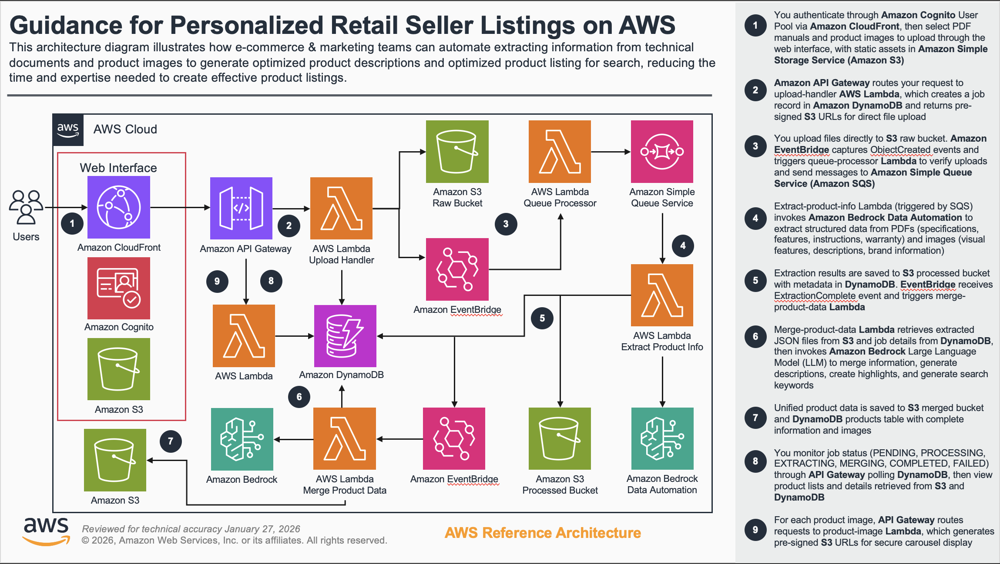

# Guidance for Personalized Retail Seller Listings on AWS

## Table of Contents

1. [Overview](#overview)
    - [Cost](#cost)
2. [Prerequisites](#prerequisites)
    - [Operating System](#operating-system)
    - [AWS Account Requirements](#aws-account-requirements)
    - [AWS CDK Bootstrap](#aws-cdk-bootstrap)
3. [Automated Deployment](#automated-deployment)
4. [Manual Deployment](#manual-deployment)
5. [Deployment Validation](#deployment-validation)
6. [Running the Guidance](#running-the-guidance)
7. [Next Steps](#next-steps)
8. [Cleanup](#cleanup)
9. [Notices](#notices)
10. [FAQ, Known Issues, Additional Considerations, and Limitations](#faq-known-issues-additional-considerations-and-limitations)

## Overview

The Guidance for Personalized Retail Seller Listings on AWS is a serverless application that helps e-commerce businesses and product marketers create compelling product descriptions and optimize product listings for search. By automating the extraction of information from technical documents and product images, and then generating marketing content, the system significantly reduces the time and expertise required to create effective product listings.

This Guidance addresses the challenge of manually creating product descriptions from technical documentation. E-commerce sellers often receive product manuals and images but lack the time or expertise to transform this information into engaging marketing content. This Guidance automates that process using AI-powered document processing and content generation.

### Architecture

The application follows a serverless, event-driven architecture with asynchronous processing:



### Architecture Flow


1. You authenticate through Amazon Cognito User Pool via Amazon CloudFront, then select PDF manuals and product images to upload through the web interface, with static assets in Amazon Simple Storage Service (Amazon S3)

2. Amazon API Gateway routes your request to upload-handler AWS Lambda, which creates a job record in Amazon DynamoDB and returns pre-signed S3 URLs for direct file upload

3. You upload files directly to S3 raw bucket. Amazon EventBridge captures ObjectCreated events and triggers queue-processor Lambda to verify uploads and send messages to Amazon Simple Queue Service (Amazon SQS)

4. Extract-product-info Lambda (triggered by SQS) invokes Amazon Bedrock Data Automation to extract structured data from PDFs (specifications, features, instructions, warranty) and images (visual features, descriptions, brand information)

5. Extraction results are saved to S3 processed bucket with metadata in DynamoDB. EventBridge receives ExtractionComplete event and triggers merge-product-data Lambda

6. Merge-product-data Lambda retrieves extracted JSON files from S3 and job details from DynamoDB, then invokes Amazon Bedrock Large Language Model (LLM) to merge information, generate descriptions, create highlights, and generate search keywords

7. Unified product data is saved to S3 merged bucket and DynamoDB products table with complete information and images

8. You monitor job status (PENDING, PROCESSING, EXTRACTING, MERGING, COMPLETED, FAILED) through API Gateway polling DynamoDB, then view product lists and details retrieved from S3 and DynamoDB

9. For each product image, API Gateway routes requests to product-image Lambda, which generates pre-signed S3 URLs for secure carousel display

### Key Features

- Upload PDF manuals and product images
- Extract product information using AI
- Generate product descriptions and search keywords
- View and manage products through a web interface
- Update existing products with new information
- Secure authentication and authorization

### Cost

You are responsible for the cost of the AWS services used while running this Guidance. As of February 2025, the cost for running this Guidance with the default settings in the US East (N. Virginia) Region is approximately $98 per month for processing 500 products with 1,000 monthly active users.

We recommend creating a [Budget](https://docs.aws.amazon.com/cost-management/latest/userguide/budgets-managing-costs.html) through [AWS Cost Explorer](https://aws.amazon.com/aws-cost-management/aws-cost-explorer/) to help manage costs. Prices are subject to change. For full details, refer to the pricing webpage for each AWS service used in this Guidance.

### Sample Cost Table

The following table provides a sample cost breakdown for deploying this Guidance with the default parameters in the US East (N. Virginia) Region for one month.

| AWS Service | Dimensions | Cost [USD] |
|-------------|------------|------------|
| AWS Lambda | 500 products/month, 5 functions, 512MB memory, 30s avg execution | $75.00 |
| Amazon S3 | 2.5GB storage, 1,500 PUT requests, 5,000 GET requests | $1.65 |
| Amazon DynamoDB | 500 write requests, 5,000 read requests, 1GB storage | $2.50 |
| Amazon Bedrock | 500 products, 10K input tokens + 5K output tokens per product | $15.00 |
| Amazon API Gateway | 10,000 REST API calls per month | $3.50 |
| Amazon CloudFront | 10GB data transfer, 10,000 requests | $0.10 |
| Amazon EventBridge | 1,000 custom events | $0.10 |
| Amazon SQS | 1,000 requests | $0.04 |
| Amazon Cognito | 1,000 active users per month | $0.00 |
| **Total Monthly Cost** | | **$97.89** |

## Prerequisites

### Operating System

These deployment instructions are optimized to best work on Amazon Linux 2023. Deployment on another OS may require additional steps.

Required software:
- **Node.js 18+** and npm
- **AWS CLI** configured with appropriate credentials
- **Git** for cloning the repository

### AWS Account Requirements

This deployment requires:
- AWS account with permissions to create the required resources
- [Enable foundation model access](https://docs.aws.amazon.com/bedrock/latest/userguide/model-access.html) in your AWS account:
  - Enable all Amazon Titan models
  - Enable all Anthropic Claude models

### AWS CDK Bootstrap

This Guidance uses AWS CDK. If you are using AWS CDK for the first time in your AWS account and Region, you need to bootstrap your environment:

```bash
npm install -g aws-cdk
cdk bootstrap aws://ACCOUNT-NUMBER/REGION
```

Replace `ACCOUNT-NUMBER` with your AWS account ID and `REGION` with your target AWS Region (e.g., us-east-1).

## Automated Deployment

This section provides the quickest path to deploy the Guidance using an automated script.

For automated deployment, a one-click deploy script (`deploy.sh`) is available in the `scripts/` directory. This script automates all deployment steps including dependency installation, resource creation, and validation.

**Usage:**

```bash
# Clone the repository
git clone https://github.com/aws-solutions-library-samples/guidance-for-personalized-retail-seller-listings-on-aws.git
cd guidance-for-personalized-retail-seller-listings-on-aws

# Make the script executable and run it
chmod +x scripts/deploy.sh
./scripts/deploy.sh
```

**What the script does:**
- Installs all required dependencies automatically (Node.js 18+, AWS CDK)
- Creates resources with dynamic naming to avoid conflicts
- Deploys the complete infrastructure (all CDK stacks)
- Creates Cognito user with generated credentials
- Configures and deploys the website
- Validates the deployment was successful
- Provides detailed logging for troubleshooting

**Environment:**
- Designed for AWS CodeBuild environments running Amazon Linux 2023
- Can also be run on Amazon Linux 2023 EC2 instances or local environments
- Requires AWS CLI configured with appropriate credentials

**Note:** For a detailed understanding of each deployment step, see the [Manual Deployment](#manual-deployment) section below.

## Manual Deployment

This section provides step-by-step instructions for manual deployment. Use this if you want to understand each step in detail or customize the deployment process.

### Step 1: Clone the Repository

```bash
git clone https://github.com/aws-solutions-library-samples/guidance-for-personalized-retail-seller-listings-on-aws.git
cd guidance-for-personalized-retail-seller-listings-on-aws
```

### Step 2: Install CDK Dependencies

```bash
cd cdk
npm install
cd ..
```

### Step 3: Configure the Application

Create a copy of the template configuration file and edit it with your specific settings:

```bash
cp cdk/bin/config/template.infra.config.json cdk/bin/config/infra.config.json
```

Edit `cdk/bin/config/infra.config.json`:

```json
{
    "stackPrefix": "PDG",
    "env": {
        "account": "<YOUR_AWS_ACCOUNT>",
        "region": "<YOUR_AWS_REGION>"
    },
    "cdkNag": true
}
```

Replace `<YOUR_AWS_ACCOUNT>` with your AWS account ID and `<YOUR_AWS_REGION>` with your target Region (e.g., us-east-1).

### Step 4: Deploy the AWS Infrastructure

```bash
cd cdk

# Bootstrap the AWS Region (if not already done)
cdk bootstrap

# Deploy all CDK stacks
cdk deploy --all
```

This will deploy all the stacks:
- StorageStack (S3 buckets, DynamoDB tables)
- AuthStack (Cognito authentication)
- QueueStack (SQS queues)
- EventBusStack (EventBridge event bus)
- LambdaFunctionsStack (Lambda functions)
- ApiStack (API Gateway)
- BedrockResourcesStack (Bedrock Data Automation)
- EventRulesStack (EventBridge rules)
- ProductWebsiteStack (Website hosting)

### Step 5: Capture Deployment Outputs

After deployment completes, capture the following outputs from the CloudFormation console or using AWS CLI:

```bash
# Get User Pool ID
aws cloudformation describe-stacks \
    --stack-name PDG-AuthStack \
    --query "Stacks[0].Outputs[?OutputKey=='UserPoolId'].OutputValue" \
    --output text

# Get User Pool Client ID
aws cloudformation describe-stacks \
    --stack-name PDG-AuthStack \
    --query "Stacks[0].Outputs[?OutputKey=='UserPoolClientId'].OutputValue" \
    --output text

# Get API Gateway URL
aws cloudformation describe-stacks \
    --stack-name PDG-ApiStack \
    --query "Stacks[0].Outputs[?OutputKey=='ApiEndpoint'].OutputValue" \
    --output text
```

### Step 6: Configure Website Environment Variables

Create a copy of the template configuration file and edit it with the outputs from Step 5:

```bash
cd ../website
cp src/config/template.runtime.config.json src/config/runtime.config.json
```

Edit `website/src/config/runtime.config.json`:

```json
{
  "userPoolId": "<USER_POOL_ID>",
  "userPoolWebClientId": "<USER_POOL_CLIENT_ID>",
  "restApiEndpoint": "<API_GATEWAY_URL>"
}
```

### Step 7: Create a Cognito User

```bash
# Create a user in the Cognito User Pool
aws cognito-idp admin-create-user \
  --user-pool-id <USER_POOL_ID> \
  --username admin \
  --user-attributes Name=email,Value=<your-email@example.com> Name=email_verified,Value=true \
  --temporary-password Temp123!

# Set a permanent password for the user
aws cognito-idp admin-set-user-password \
  --user-pool-id <USER_POOL_ID> \
  --username admin \
  --password <YourStrongPassword123!> \
  --permanent
```

Replace `<USER_POOL_ID>` with the User Pool ID from Step 5, and `<your-email@example.com>` and `<YourStrongPassword123!>` with your desired credentials.

### Step 8: Deploy the Website

```bash
# Install website dependencies
npm install

# Build and deploy the website
npm run deploy
```

The deploy script will:
1. Build the React application
2. Upload the built files to the S3 bucket
3. Create a CloudFront invalidation to update the cache
4. Output the website URL

## Deployment Validation

To validate a successful deployment:

1. Open the AWS CloudFormation console and verify that all stacks with names starting with `PDG-` show `CREATE_COMPLETE` status:
   - PDG-StorageStack
   - PDG-AuthStack
   - PDG-QueueStack
   - PDG-EventBusStack
   - PDG-LambdaFunctionsStack
   - PDG-ApiStack
   - PDG-BedrockResourcesStack
   - PDG-EventRulesStack
   - PDG-ProductWebsiteStack

2. Verify the CloudFront distribution is active:
   ```bash
   aws cloudformation describe-stacks \
       --stack-name PDG-ProductWebsiteStack \
       --query "Stacks[0].Outputs[?OutputKey=='WebsiteUrl'].OutputValue" \
       --output text
   ```

3. Test the API Gateway endpoint:
   ```bash
   curl -I <API_GATEWAY_URL>/products
   ```
   You should receive a 401 or 403 response (authentication required), which confirms the API is accessible.

4. Verify the Cognito User Pool has the admin user:
   ```bash
   aws cognito-idp admin-get-user \
       --user-pool-id <USER_POOL_ID> \
       --username admin
   ```

## Running the Guidance

### Accessing the Application

1. Open the website CloudFront URL in your browser (provided at the end of the deployment process)
2. Sign in with the Cognito user credentials you created

### Uploading Product Files

#### Synthetic Product Data

Five synthetic products are included in this project in the `products` directory:
- [Coffee Maker](./products/coffee-maker-deluxe/input/)
- [Fitness Watch](./products/fitness-watch-pro/input/)
- [Noise Cancelling Headphones](./products/noise-cancelling-headphones/input/)
- [Premium Blender](./products/premium-blender/input/)
- [Robot Vacuum](./products/robotic-vacuum/input/)

#### Upload Instructions

1. After signing in, you'll be directed to the Upload page
2. Choose whether you're creating a new product or updating an existing one
   - For new products, the system will generate a product ID automatically
   - For existing products, select the product from the dropdown menu
3. Click "Choose Files" to select PDF manuals and/or product images
   - Supported file types: PDF, PNG, JPG, JPEG
4. Click "Upload Files" to start the upload process
5. You'll be redirected to the Job Status page where you can monitor the processing progress

### Expected Output

After uploading files, you should see:

1. **Job Status Page**: Shows the current status of the processing job
   - Status: PENDING → PROCESSING → EXTRACTING → MERGING → COMPLETED
   - List of files being processed
   - Any errors that occurred
   - A link to view the product when processing is complete

2. **Product Page**: Once processing is complete, the product page displays:
   - Product images in a carousel
   - Product name, brand, and description
   - Key features and specifications
   - Usage instructions and warranty information
   - Categories and keywords

### Viewing Products

1. Click on the "Products" tab in the navigation bar
2. Browse the list of products
3. Click on a product to view its details

### Updating Existing Products

1. Go to the Upload page
2. Check "Update Existing Product"
3. Select the product you want to update from the dropdown
4. Upload new files (PDF manuals and/or images)
5. The system will merge the new information with the existing product data

## Next Steps

To customize this Guidance for your specific use case:

1. **Customize Bedrock Data Automation Blueprints**: Modify the extraction blueprints in the BedrockResourcesStack to extract specific product attributes relevant to your industry or product category.

2. **Enhance Product Schema**: Extend the Product data model in `cdk/lambda/types/product.ts` to include additional fields specific to your business needs (e.g., SKU, inventory levels, supplier information).

3. **Implement Advanced Search**: Add Amazon OpenSearch Service to enable full-text search and filtering capabilities across product descriptions and keywords.

4. **Add Multi-Language Support**: Integrate Amazon Translate to generate product descriptions in multiple languages for international marketplaces.

5. **Implement Approval Workflow**: Add a review and approval step using AWS Step Functions before publishing generated content to ensure quality control.

6. **Integrate with E-commerce Platforms**: Connect the system to your existing e-commerce platform (Shopify, Magento, etc.) using API integrations to automatically update product listings.

7. **Add Analytics Dashboard**: Implement Amazon QuickSight to visualize product processing metrics, content quality scores, and system usage patterns.

8. **Optimize Costs**: Implement S3 lifecycle policies to transition older files to S3 Glacier, and configure DynamoDB TTL to automatically delete old job records.

## Cleanup

To avoid ongoing charges, delete the resources created by this Guidance:

1. Empty the S3 buckets before deletion:
   ```bash
   # List all buckets created by the Guidance
   aws s3 ls | grep pdg

   # Empty each bucket (replace <bucket-name> with actual bucket names)
   aws s3 rm s3://<bucket-name> --recursive
   ```

2. Delete all CDK stacks:
   ```bash
   cd cdk
   cdk destroy --all
   ```

3. Confirm the deletion when prompted by typing `y`.

4. Verify all resources are deleted by checking the CloudFormation console for any remaining stacks with names starting with `PDG-`.

**Note**: Some resources like CloudWatch Logs may be retained for a period after stack deletion. These will incur minimal costs and can be manually deleted from the CloudWatch console if desired.

## Notices

Customers are responsible for making their own independent assessment of the information in this Guidance. This Guidance: (a) is for informational purposes only, (b) represents AWS current product offerings and practices, which are subject to change without notice, and (c) does not create any commitments or assurances from AWS and its affiliates, suppliers or licensors. AWS products or services are provided "as is" without warranties, representations, or conditions of any kind, whether express or implied. AWS responsibilities and liabilities to its customers are controlled by AWS agreements, and this Guidance is not part of, nor does it modify, any agreement between AWS and its customers.

## FAQ, Known Issues, Additional Considerations, and Limitations

### Known Issues

1. **Cold Start Latency**: Lambda functions may experience cold start delays (2-5 seconds) for the first request after a period of inactivity. This is normal behavior for serverless applications.

2. **Large File Processing**: Files larger than 10MB may take longer to process. Consider implementing file size validation in the frontend to warn users about extended processing times.

3. **Concurrent Processing Limits**: The default Lambda concurrency limit may throttle requests during high-volume uploads. Monitor CloudWatch metrics and request limit increases if needed.

### Additional Considerations

- **Demo vs Production**: This Guidance is designed as a demonstration. For production use, consider adding:
  - Web Application Firewall (WAF) in front of CloudFront and API Gateway
  - Multi-factor authentication (MFA) for Cognito users
  - Customer-managed IAM roles with least privilege policies instead of AWS managed roles
  - Enhanced monitoring and alerting with CloudWatch Alarms
  - Backup and disaster recovery procedures

- **Data Privacy**: Uploaded product documents and images are stored in S3. Ensure compliance with your organization's data retention and privacy policies.

- **Bedrock Model Access**: This Guidance requires access to Amazon Bedrock foundation models. Model availability and pricing vary by Region. Verify model access in your target Region before deployment.

- **Cost Scaling**: Costs scale with usage. Monitor your AWS Cost Explorer dashboard regularly, especially during initial testing with large product catalogs.

For any feedback, questions, or suggestions, please use the issues tab in the GitHub repository.
